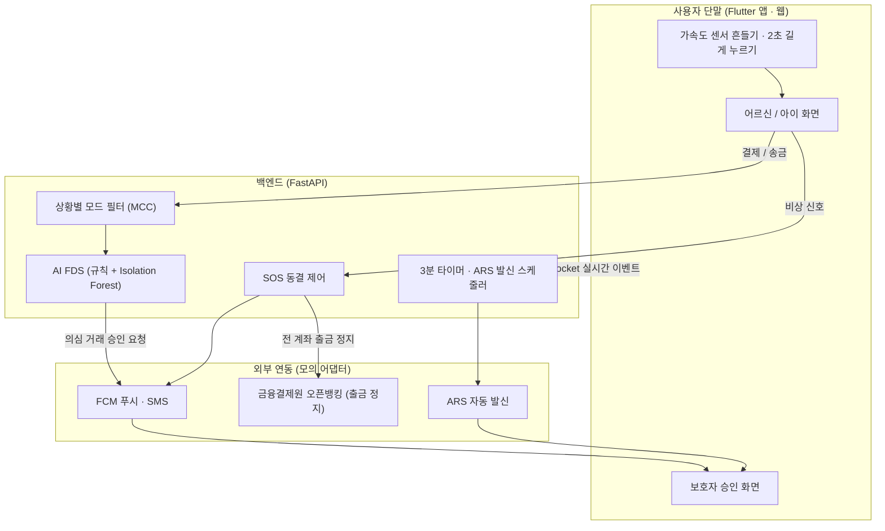

# 핑거벨 (FingerBell)

**금융 취약계층(노인·아동)을 위한 모션 제어 및 보호자 연동형 안심 뱅킹 서비스**

2026 디지털새싹 문제해결 경진대회(CODE) 트랙 1 · 팀 핑거스냅 (한국게임과학고등학교)

[](https://github.com/Tristan-2021/finance_tech/actions/workflows/ci.yml)


> 위급할 땐 흔들고, 큰돈은 함께 확인해요.

## 핵심 기능

| 기능 | 하는 일 | 구현 위치 |
| :--- | :--- | :--- |
| **원터치 SOS 계좌 동결** | 휴대폰을 3초 동안 세게 흔들거나(3축 가속도 2.5g 이상) SOS 버튼을 2초 누르면, 연동된 **모든 계좌의 출금이 24시간** 멈추고 보호자에게 푸시·문자가 갑니다. 24시간이 지나거나 보호자가 풀어 줄 때만 해제됩니다. | 서버 `backend/app/service.py` `freeze()` · 앱 `feature_sos` |
| **AI FDS + 보호자 콜백 승인** | 송금마다 위험도(0~99점)를 매깁니다. 의심 거래는 **송금을 보류**하고 보호자 앱에 알립니다. 20초 안에 확인하지 않으면 **ARS 전화**("승인은 1번, 거절은 2번")를 걸고, **3분** 안에 답이 없으면 자동 취소합니다. | `backend/app/domain/fds.py` · `feature_transfer` · `feature_guardian` |
| **상황별 안심 모드** | 등교 모드(교통·문구·편의점·서점·식당), 병원 모드(병원·약국·교통·마트)처럼 **가맹점 업종(MCC) 화이트리스트**로 결제를 제한합니다. 수면 안심 모드는 23:00~06:00 이체를 보호자 확인 뒤에만 보냅니다. | `backend/app/domain/catalog.py` · `feature_payment` |
| **취약계층 맞춤 화면** | 어르신 화면은 기본 글자를 키우고 큰 버튼 [송금]·[결제]·[조회]와 [SOS]만 둡니다. 큰 글씨, 고대비, 음성 안내(TTS), 잔액 숨기기를 켤 수 있습니다. 보호자는 가족 상태·알림·한도·모드를 원격으로 관리합니다. | `packages/app` · `core_ui` |
| **누구나 같은 은행 기능** | 어르신·아이·보호자 모두 내 계좌 잔액, 송금(AI 안심 점검 포함), 결제, 거래 내역을 씁니다. 차이는 보호 장치뿐입니다: 보호자 본인 송금은 위험도를 보여 주고 본인 확인 후 바로 보내며, 안심 모드·SOS 동결·보호자 승인은 가족에게만 씁니다. 핑거벨 안의 가족 계좌로 보낸 돈(예: 아이 용돈)은 받는 계좌에 바로 들어갑니다. | `backend/app/service.py` · `packages/app/lib/views` |

### AI 이상거래탐지(FDS)

위험도는 **설명 가능한 규칙**과 **비지도 학습 모델**을 합쳐 계산합니다.

| 신호 | 기준 (기획서 3.2) | 점수 |
| :--- | :--- | ---: |
| 신규 계좌 | 등록되지 않았고 최근 6개월 송금 이력이 없는 계좌 | +35 |
| 이상 금액 | 최근 3개월 평균 송금액의 300% 초과 | +30 |
| 분할 송금 | 10분 안에 이미 2번 이상 송금 시도 | +25 |
| 한도 초과 | 오늘 쓴 돈 + 이번 금액이 하루 한도 초과 | +20 |
| 심야 | 23:00~06:00 | +15 |
| 패턴 이상 | **Isolation Forest**가 사용자의 최근 6개월 출금(금액·시간대·신규 여부·연속 시도)과 다르다고 판단 | +5~15 |

기본 5점에 더해 60점 이상은 **위험**, 30점 이상은 **주의**입니다. 주의·위험이거나, 보호자 확인 금액(어르신 30만원, 아이 1만원) 이상이거나, 수면 안심 시간이면 보호자 승인을 거칩니다. 위험도는 항상 서버가 다시 계산하므로 앱이 점수를 조작할 수 없습니다.

## 시스템 구조



앱은 서버의 가족 상태(`GET /api/v1/state`)를 그리고, 상태가 바뀌면 WebSocket(`/api/v1/ws`) 이벤트를 받아 다시 불러옵니다. 그래서 **휴대폰 두 대**(어르신 폰·보호자 폰)로도, 한 화면에서 사용자를 바꿔 가며도 같은 흐름을 시연할 수 있습니다.

외부 연동(오픈뱅킹·FCM·SMS·ARS)은 지금 **모의 어댑터**입니다. 실제 API와 같은 형식의 호출 기록을 남기고(설정 › 서버 연동 기록), `backend/app/integrations.py`의 같은 메서드를 가진 클래스로 바꾸면 실제 연동이 됩니다.

## 저장소 구조

```
backend/                    FastAPI 서버 · SQLite(기본)/PostgreSQL · AI FDS · 테스트
  app/domain/fds.py         규칙 + Isolation Forest 위험도
  app/domain/catalog.py     안심 모드 · 업종(MCC) · 시연 가맹점
  app/service.py            SOS 동결 · 송금 보류/승인 · 결제 제어 · 타이머 · ARS
  app/integrations.py       오픈뱅킹 · FCM · SMS · ARS 어댑터 (모의)
packages/
  app/                      셸: 웹(16:9 사이드바·2단)/모바일(하단 메뉴) 레이아웃, 화면 연결
  core/
    core_api/               HTTP · WebSocket 클라이언트
    core_family/            가족 상태 모델 · 저장소 · FamilyCubit (서버와 실시간 동기화)
    core_shell/             지금 사용자·탭·화면 설정 · 피드백 요청 (ShellCubit)
    core_ui/                디자인 시스템 (파랑·빨강 토큰, 고대비, 공용 위젯)
    core_errors/            공통 Failure
  features/
    feature_sos/            흔들기 감지 · SOS 버튼 · 동결 화면
    feature_transfer/       AI 안심 점검을 거치는 송금 시트
    feature_payment/        안심 모드를 따르는 결제 시트
    feature_guardian/       보호자 승인 · 가족 관리 · ARS 확인 전화
```

기능 패키지는 서로 의존하지 않고 `core_*`에만 의존합니다. 기능끼리는 `app`에서만 연결합니다.

## 실행하기 (Windows)

필요한 것: [Flutter](https://docs.flutter.dev/get-started/install), Python 3.11 이상(또는 [uv](https://docs.astral.sh/uv/)), Android는 Android SDK.

### 1. 백엔드

```powershell
.\run-backend.ps1
```

처음 실행하면 `backend/.venv`를 만들고 패키지를 설치합니다. API 문서는 <http://127.0.0.1:8765/docs> 입니다. `-Reset`을 붙이면 시연 데이터를 처음 상태로 되돌립니다.

### 2-A. 웹 (한 번에)

```powershell
.\run-backend.ps1 -WithWeb
```

Flutter 웹을 빌드해 같은 서버에서 제공합니다. <http://127.0.0.1:8765> 를 여세요. 화면 폭이 900px 이상이면 웹(16:9) 레이아웃, 좁으면 모바일 레이아웃입니다.

### 2-B. 웹 (개발 · 핫 리로드)

```powershell
.\run-web.ps1
```

### 2-C. Android

```powershell
.\run-android.ps1
```

에뮬레이터를 켜고 `adb reverse tcp:8765 tcp:8765`로 기기의 `127.0.0.1:8765`를 이 PC의 백엔드에 연결한 뒤 앱을 실행합니다. USB로 연결한 실제 휴대폰도 `-Device <기기 ID>`로 같게 쓰면 됩니다.

같은 Wi-Fi의 휴대폰에서 웹으로 접속하려면 `.\run-backend.ps1 -WithWeb -Lan`으로 실행하고 `http://<PC의 IP>:8765`를 엽니다 (Windows 방화벽 허용 필요).

IntelliJ / Cursor / VS Code에는 **FingerBell (Android)**, **FingerBell (Web)** 실행 구성이 있습니다.

## 시연 시나리오

웹은 사이드바 아래, 모바일은 설정 탭의 **바로 시연해 보기**에서 바로 시작할 수 있습니다.

1. **흔들어서 SOS 동결**: 어르신 화면이 흔들리고 → 전 계좌 출금 동결 → 빨간 동결 화면과 24시간 카운트다운 → 보호자 화면에 "동결 중".
2. **낯선 계좌로 50만원 송금**: AI 안심 점검이 위험(80점대)으로 판정 → 보호자에게 확인 요청 → 20초 뒤 ARS 전화 → 보호자가 거절하면 돈은 나가지 않고 "보호자가 거절했어요" 안내.
3. **등교 모드에서 게임 결제**: 게임 업종(MCC 5816)은 등교 모드 화이트리스트에 없어 차단 → 보호자에게 요청 → 승인되면 결제.

**두 기기 시연**: 한 기기는 어르신, 다른 기기는 보호자로 고른 뒤 어르신 기기에서 송금하면 보호자 기기에 바로 요청이 뜹니다. 보호자가 요청을 보고 있지 않으면(예: 관리 탭) 20초 뒤 ARS 확인 전화 화면이 뜹니다.

## 주요 API (기획서 5.1)

| 메서드 · 경로 | 설명 |
| :--- | :--- |
| `POST /api/v1/security/sos-freeze` (`/api/v1/emergency/freeze`) | SOS 동결. `user_id`, `trigger_type`(SHAKE_MOTION / LONG_PRESS / GUARDIAN_REMOTE), `sensor_intensity` → `status`, `frozen_accounts_count`, `freeze_expires_at`, `guardian_notified` |
| `POST /api/v1/transaction/assess` | 송금 전 AI 안심 점검 (저장하지 않음) |
| `POST /api/v1/transaction/transfer` | 송금. 안전하면 바로 보내고, 아니면 보호자 승인 대기 |
| `POST /api/v1/transaction/request-approval` | 이상 거래 콜백 승인 요청 → `transaction_id`, `status: PENDING_APPROVAL`, `timeout_seconds: 180` |
| `POST /api/v1/guardian/callback-decision` | 보호자 승인/거절. `transaction_id`, `guardian_id`, `decision`(APPROVE / REJECT), `reason` |
| `POST /api/v1/ars/callback` | ARS 키 입력 (`1` 승인, `2` 거절) |
| `POST /api/v1/payments/pay` · `/payments/request-approval` | 안심 모드를 따르는 결제 / 막힌 결제의 보호자 요청 |
| `POST /api/v1/modes` · `/guardian/limits` · `/guardian/sleep-guard` | 안심 모드 · 하루 한도 · 수면 안심 모드 |
| `GET /api/v1/state` · `WS /api/v1/ws` | 가족 전체 상태 · 실시간 이벤트 |

전체 목록과 요청 형식은 실행 중인 서버의 `/docs`(Swagger)에 있습니다.

## 서버 설정 (환경변수)

| 이름 | 기본값 | 설명 |
| :--- | :--- | :--- |
| `FINGERBELL_DATABASE_URL` | `sqlite:///backend/fingerbell.db` | PostgreSQL은 `postgresql+psycopg://...` (`psycopg[binary]` 설치) |
| `FINGERBELL_APPROVAL_TIMEOUT` | `180` | 보호자 승인 대기(초) |
| `FINGERBELL_ARS_AFTER` | `20` | 푸시를 확인하지 않으면 ARS 전화를 거는 시점(초) |
| `FINGERBELL_FREEZE_HOURS` | `24` | SOS 동결 유지 시간 |
| `FINGERBELL_WEB_DIR` | `packages/app/build/web` (있으면) | 함께 제공할 웹 빌드 폴더. `FINGERBELL_NO_WEB=1`이면 끕니다 |

앱의 서버 주소는 `--dart-define=FINGERBELL_API_URL=http://<주소>:8765`로 바꿉니다.

## 테스트

```powershell
# 백엔드 (56개: SOS · FDS · 승인/타임아웃/ARS · 안심 모드 · 실시간 · 공통 은행 기능)
cd backend; .\.venv\Scripts\python.exe -m pytest

# Flutter (패키지마다)
melos bootstrap
melos run analyze
melos run test
```

## 알아 둘 점

- 시연용 가상 데이터를 쓰며 실제 은행·금융 서비스와 연결되지 않습니다.
- 흔들기 감지는 휴대폰(Android/iOS 앱, 휴대폰 브라우저)에서만 동작합니다. PC에서는 "흔들어서 SOS 동결" 시나리오 버튼으로 시연하세요.
- 한글 글꼴 **Noto Sans KR**(가변 글꼴, SIL Open Font License 1.1)을 앱에 넣었습니다(`packages/core/core_ui/assets/fonts/`, 라이선스는 같은 폴더의 `OFL.txt`이고 앱의 설정 › 오픈소스 라이선스에서도 볼 수 있습니다). `run-backend.ps1 -WithWeb`은 CanvasKit도 서버에서 제공하도록 빌드하므로, **인터넷이 없는 곳에서도** 웹 시연이 됩니다.
- 이 저장소는 오픈소스 학습용 은행 앱 [Tristan-2021/finance_tech](https://github.com/Tristan-2021/finance_tech)의 모노레포 구조를 바탕으로 핑거벨에 맞게 다시 만들었습니다. `documentacion/`은 원작의 문서(스페인어)입니다.
